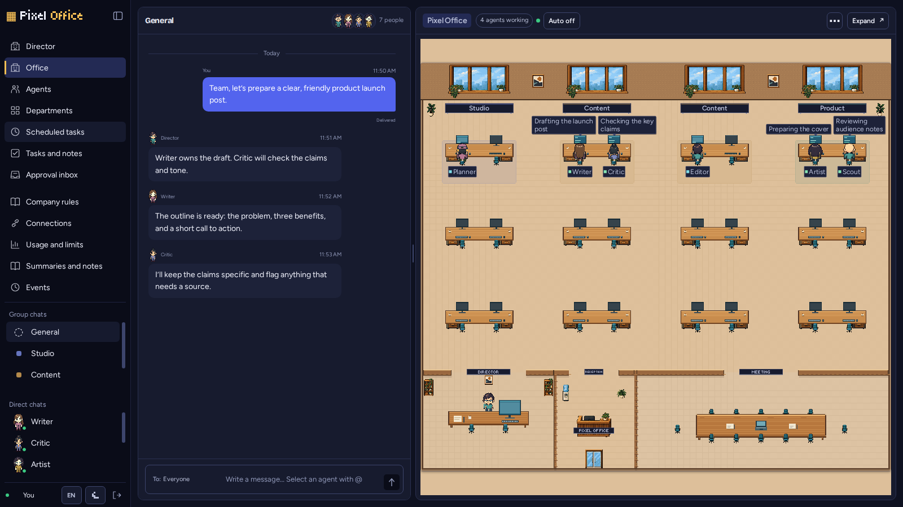
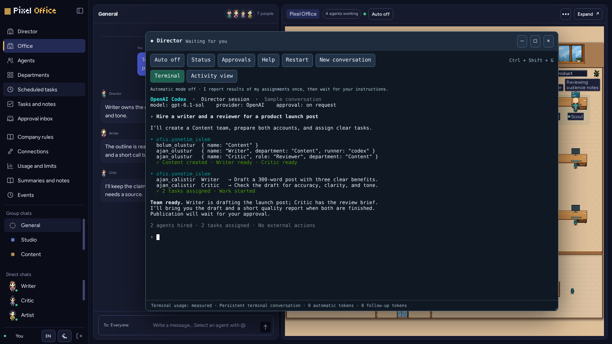
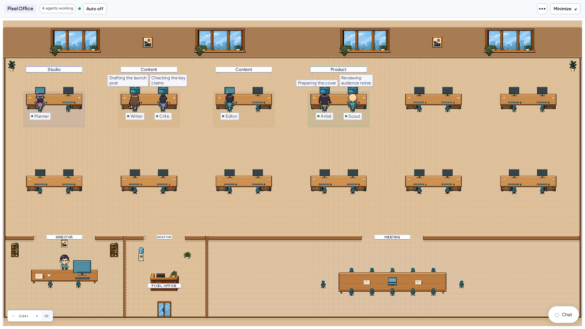
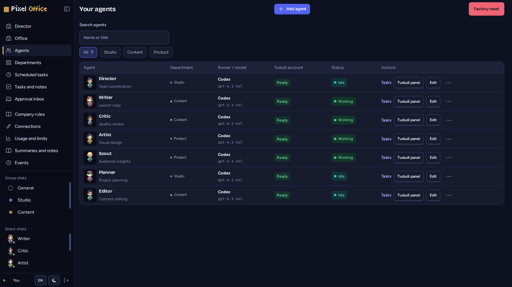
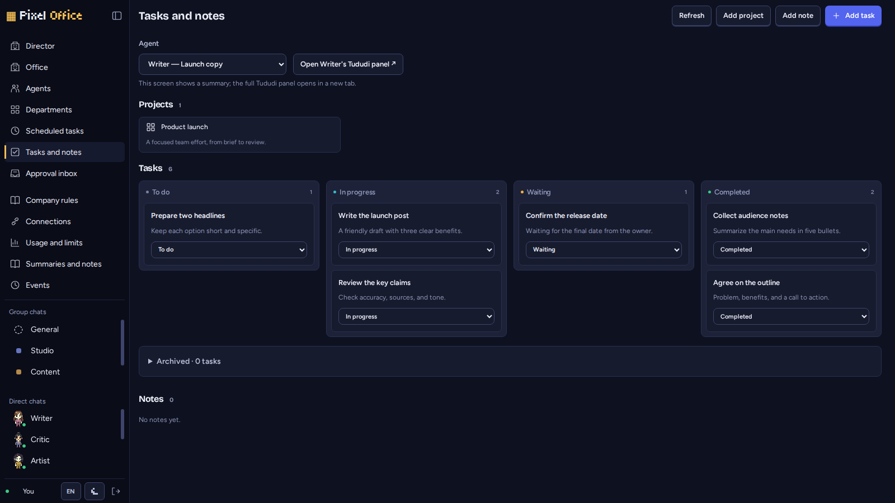

# Pixel Office

Security boundaries, supported deployments, and private vulnerability reporting:
[SECURITY.md](SECURITY.md).

[English](README.md) · [Turkish](README.tr.md)

## What it is

Pixel Office lets you manage AI agents as a team working in the same company. You create the departments and employees, then follow their tasks, conversations and status in a live pixel office. Each agent has its own Tududi account, tasks and workbook. Use the Director terminal to talk to the team, assign work and track results.

It works for any line of business. New installations start without a sample company or industry-specific data. The interface supports **English and Turkish**. A new office always starts in English, regardless of the browser language. Select Turkish with the TR/EN control or office language setting. Change the saved office language in the bottom-left user controls or under Usage and limits → Office language. Existing offices keep their saved language after upgrading. Agent instructions, names, notes and past events are not translated.

## Screenshots

All screenshots use fictional sample data. The connected runner and Director session are simulated; no model calls were made.





| Expanded office · light theme | Agents · ready accounts | Tasks and notes |
| --- | --- | --- |
| [](docs/images/office-expanded.png) | [](docs/images/agents.png) | [](docs/images/tasks.png) |

## Requirements

- Docker Engine and the Docker Compose plugin.
- Linux server, Node.js **24 or later**, `bubblewrap` (`bwrap`), `tmux` and Python 3. The runner runs on the host, outside the containers. User namespaces must be enabled.
- For optional Claude agents and the Director terminal: Claude Code **2.1.285 or later**, with a dedicated Claude account. **Claude support is experimental — not tested with a real account.**
- Codex CLI **0.138 or later** and a Codex/ChatGPT account with Codex access. The account's model access and usage limits apply. CLI options were tested with 0.159.1; the minimum terminal version does not guarantee compatibility with every version.
- If needed to build `node-pty` when installing Node dependencies: `make` and a C++ compiler.
- The adapted Tududi image: **`pixel-office-tududi:0.87-po.5`**. The standard Tududi image is not a substitute. Its source will be published separately at `https://github.com/mrekinci-com/pixel-office-tududi`; follow that repository's image preparation instructions.

Node.js and Codex must be accessible to the Linux user running the service. The runner does not support Windows or macOS.

## Installation

The `OFIS_*` environment variable names and `PIKSEL_OFIS_TUDUDI_IMAGE` are retained for backward compatibility. Keep using these names with the English folders and service names; `OFFICE_*` aliases are not implemented.

The Compose project is `pixel-office`. Services are `office`, `tududi` and `tududi-proxy`; containers are `pixel-office`, `pixel-office-tududi` and `pixel-office-tududi-proxy`. The host service is `pixel-office-runner.service`.

These instructions are for a new, separate installation. Do not use `%` in the installation path; the tested Compose version cannot resolve it. For an existing installation, preserve data and secret configuration files. Do not share the same project name and ports with a second installation.

```sh
git clone https://github.com/mrekinci-com/pixel-office.git
cd pixel-office
bash scripts/install.sh
```

The preparation command does not start containers or services and does not install packages. It creates four local files from examples: root `.env`, `tududi/.env`, `office/.env` and `runner/.env`. It generates random owner and Tududi passwords, session and encryption secrets, and a shared runner key. Secrets are not printed; new configuration files are readable only by their owner (0600). Existing settings are preserved; preparation stops on mismatched keys or administrator credentials. Installer help, diagnostics and generated configuration comments are always in English, independently of `LANG`. The web interface retains its selected language.

1. Before the first startup, replace `TUDUDI_USER_EMAIL` in `tududi/.env` with your administrator email. Set the same address in `TUDUDI_ADMIN_EMAIL` in `office/.env`. If you change the password, change it in both files. These credentials belong only to the separate Tududi used by agents.
2. `OFIS_OWNER_PASSWORD` in `office/.env` is your panel sign-in password. Keep it in a secure password manager. `OFIS_SECRET_KEY` is permanent; changing it makes old encrypted account credentials unreadable. `OFIS_RUNNER_KEY` must match in the office and runner.
3. In `runner/.env`, set `OFIS_CODEX_AUTH_FILE` to the absolute path of the private `auth.json` file for the Codex account dedicated to this service. Fill `OFIS_CODEX_MODELS` and `OFIS_CODEX_MODEL` with models your account can use; access is not discovered automatically. Do not copy the authentication file into the repository.
4. For file connections, set `OFIS_ALLOWED_ROOTS` to allowed absolute folder roots separated by `:`. An empty value opens no additional folders. Protect other applications by adding their roots to `OFIS_PROTECTED_ROOTS` in the same format. The repository, work root, system paths and private configuration folders are already protected. `OFIS_WORK_DIR` must belong exclusively to this runner.
5. Prepare the Tududi image using its separate repository instructions. If you use a different image name, update `PIKSEL_OFIS_TUDUDI_IMAGE` in the root `.env`.

The container user with UID 1000 must be able to write to new data folders. If your Linux user has a different ID, adjust ownership of only this installation's new `office/data`, `tududi/db` and `tududi/uploads` folders to UID/GID 1000. The preparation command does not change ownership.

### Access addresses

By default, the installation listens only on the server's `127.0.0.1` address:

| Address | Purpose |
| --- | --- |
| `http://127.0.0.1:9400` | Office panel |
| `http://127.0.0.1:9394` | Proxy for entering an agent's Tududi account |
| `http://127.0.0.1:9393` | Internal address of the separate Tududi |

For private network access, set `OFIS_PRIVATE_IP` in the root `.env` to the server's **numeric private IPv4 address** and run `bash scripts/install.sh` again. This prepares a local `docker-compose.override.yml` for the additional port 9400 binding. No additional binding is created when the address is empty. The proxy uses port 9394 on the same private address; 9393 stays local. Do not use a public address or `0.0.0.0`. To return to local-only access, clear the address and remove the private port from the local Compose override.

Office origin checks and Tududi access use the same numeric private address. Open the panel through that address. Root `.env` and local Compose overrides are excluded from publication. For an HTTPS reverse proxy, configure the public address and secure cookies separately as described in the [office documentation](office/README.md).

### Starting containers

After reviewing settings, run these commands yourself from the repository root:

```sh
docker compose config --quiet
docker compose up -d --build
```

Full `docker compose config` output may contain secrets; do not share it. The office shares Tududi's network namespace. The third container is the Tududi access proxy, using host networking and listening only on the configured local/private address. This Compose layout is for Linux. Agent account setup may remain pending until Tududi finishes its first startup; retry from the panel.

### Runner user service

Build first:

```sh
cd runner
npm ci
npm run typecheck
npm test
npm run build
cd ..
```

Preparation fills the [service template](runner/systemd/pixel-office-runner.service.example) with installation and Node paths at `.cache/install/pixel-office-runner.service`. Review it. If Codex is in another directory, add that directory to `Environment=PATH=...`. A command available in a terminal may be missing from systemd's narrower search path.

When ready to install and start the service, run these commands yourself:

```sh
mkdir -p "$HOME/.config/systemd/user"
cp .cache/install/pixel-office-runner.service "$HOME/.config/systemd/user/"
systemctl --user daemon-reload
systemctl --user enable --now pixel-office-runner.service
```

If the service must run after logout, the system administrator must enable lingering for this user. The runner performs management actions with its Linux account permissions; a dedicated service account is appropriate. Manual startup and limits: [runner documentation](runner/README.md).

## First sign-in and first task

1. Open the panel on port 9400. Sign in with the owner password in `office/.env`; no username is needed.
2. Set company rules and create departments. When adding employees, choose Codex or experimental Claude, an accessible model and task instructions. Every employee gets a separate Tududi account; pending accounts are visible in the panel.
3. Check that the runner is connected. Assign the first task through the Director terminal or message an employee directly. Tasks, messages and status appear in the office.
4. Define required folders and fixed commands in the panel. Give write and approval permissions only to employees who need them. Completing a task does not publish anything automatically.

## Security model and limitations

Each agent uses a separate workspace and Tududi account. The Linux sandbox (`bubblewrap`) exposes only required runtime files, the agent profile and allowed connections. Personal HOME, personal settings and other agents' areas are not mounted. Required authentication fields from the service account are copied into a private profile; agents may share the same account quota.

Codex shell commands have no network access. Work does not start unless file and network isolation pass a real probe. The model CLI and trusted tool bridge use the host network. This version has no domain-filtering egress proxy for the entire process. Fixed commands attached to allowed folders run in a separate sandbox without networking.

Agent keys cannot perform owner-reserved operations. Connections requiring write approval are mounted read-only for the agent. The agent prepares changes in its own workspace, the owner approves the contents, and the runner copies the approved bytes. A changed target is rejected. Multi-file copying is not an atomic transaction. A connection explicitly configured for direct writes grants that permission.

Office account secrets are encrypted; owner sessions use signed `httpOnly` cookies. Secrets and data folders are excluded from Git. Protect access to the host and Linux service account too.

For Claude, use the dedicated sign-in command printed by `bash scripts/install.sh` or shown in the employee settings panel. It opens a separate profile at `<OFIS_WORK_DIR>/.auth/claude-login`; it never imports your personal `~/.claude`. A manual equivalent (replace the absolute path with your runner work directory) is:

```sh
OFIS_CLAUDE_LOGIN_DIR=/absolute/runner-work/.auth/claude-login
mkdir -p -- "$OFIS_CLAUDE_LOGIN_DIR"
chmod 700 -- "$OFIS_CLAUDE_LOGIN_DIR"
env -i PATH="$PATH" LANG=C.UTF-8 HOME="$OFIS_CLAUDE_LOGIN_DIR" CLAUDE_CONFIG_DIR="$OFIS_CLAUDE_LOGIN_DIR" claude
```

Sign in with the account reserved for agents, then exit the CLI. Leave `OFIS_CLAUDE_AUTH_FILE` empty to use that profile's `.credentials.json`, or point it to another **dedicated** authentication file. Each run and Director conversation receives its own sanitized copy through `CLAUDE_CONFIG_DIR`; personal settings, hooks and plugins are not copied. Never add credentials to Git. Each user must check their own subscription's automation and account-use terms; this integration does not grant permission under those terms.

Choose Claude and an available model in the employee/Director settings. Defaults are `sonnet`, `opus`, `haiku`; `OFIS_CLAUDE_MODELS` may provide aliases or full model IDs. The thinking setting maps to Claude's `--effort`; the model determines supported levels. Switching the Director provider starts a new terminal generation and revokes the old tool key. Restart continues the current conversation; New conversation creates another identity. Missing authentication shows the dedicated sign-in command. Theme and workspace-trust screens, when present, are shown to the owner for an explicit choice; they are never auto-approved.

Claude uses the same outer Bubblewrap box. Only Read/Edit/Write and authorized Office MCP tools are available at file permission levels; chat has no native file tools. Native search, shell, web, subagents and skills are disabled. A read-only `/etc/claude-code/managed-settings.json`, matching command-line deny rules and a managed file guard protect credentials/MCP/settings, `/proc`, and files outside the assigned roots. Incoming files, directory maps, read-only links and approval-protected links cannot be edited directly. These controls have fake-CLI and real guard-process tests; they are **not a real Claude account or CLI enforcement test**. See [the security model](SECURITY.md).

Claude terminal usage comes from bounded dedicated-profile transcripts, deduplicated per provider message. Managed start/stop hooks supply completion evidence. Missing, unsupported, or over-8-MiB transcripts show unknown usage and prevent automatic follow-up; a new conversation restores a bounded record. Automatic injection also requires a proven completion, a current empty prompt and the existing typing delay. There is **no process-wide provider-domain egress proxy** in this repository: the trusted CLI and MCP bridge share host networking, as in the Codex path. Provider-only networking described in the C1 brief could not be inherited from an existing proxy because none exists.

**Codex operation is supported. Claude agents and the Claude Director terminal are experimental — not tested with a real Claude account.** Model access and CLI compatibility depend on your account. Test a new installation in a separate test environment before assigning real work. Agent output requires human review.

## Development and tests

In both component folders, run `npm ci`, then `npm run typecheck`, `npm test` and `npm run build`. Main tests use fake providers and require no model account or live Tududi. From the root, test the installation helper with `node --test scripts/install.test.mjs`.

Optional browser/visual checks are described in the [office documentation](office/README.md). The narrow bilingual check is `cd office && npm run test:i18n:browser`; build first. It uses request interception and Fastify injection without opening a listening port. Visual baselines live in `office/tests/__screenshots__` and do not need internal documents. Internal development records and local data are excluded from clean distributions by [the publication exclusion list](release-exclude.txt). Do not publish this repository's existing history as a clean release.

## Backups

Run `python3 scripts/backup.py` for general backups; it retains the latest 14 completed backups in `yedek/gunluk`. For a different work root, pass the `OFIS_WORK_DIR` value with `--work-dir`; see `--help`. It backs up Office/Tududi SQLite data using the backup API and copies uploads and agent work files. It excludes authentication files, private profiles, `.env` files and symbolic links. Connected external folders are included only when explicitly selected with `--folders-dir`. The tool does not modify services. Each database is internally consistent; the backup is not a single transaction snapshot across services. Test it with `python3 -B scripts/backup_test.py`.

Do not back up a running SQLite database by copying only its main file. Use SQLite's backup API or a consistent copy from stopped services. Back up `office/data`, Tududi data and agent workspaces, and store secret settings and service credentials separately in a secure place. Office cannot decrypt old account secrets without `OFIS_SECRET_KEY`. Never publish backups or `.env` files in a public repository.

## License

Code is licensed under [MIT](LICENSE). Copyright (c) 2026 mrekinci. Original artwork and fonts have separate CC0/OFL notices in [artwork licenses](office/public/assets/ASSET-LICENSES.md). The adapted Tududi is distributed separately under its own license.
